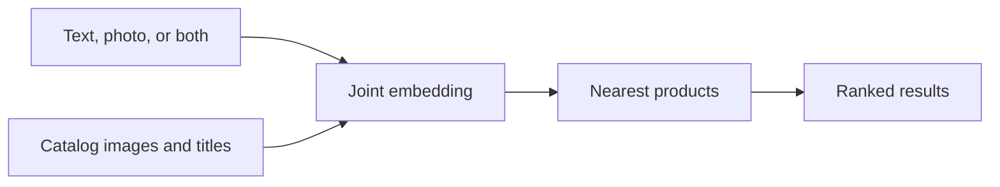
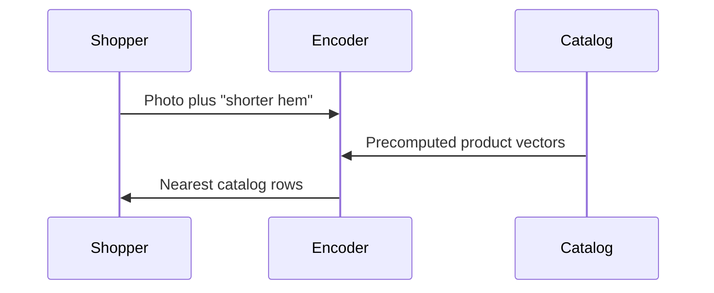

# Multimodal retail search

Product search where the query can be a sentence, a photo, or both. Text search fails when the shopper has the shoe in a picture and not the words. Image search fails when they can describe the color and not point a camera at it. A shared embedding space is the fix.



## Why one vector space

CLIP-style models place a caption and a photograph near each other when they mean the same thing. Once the catalog is embedded, a query is just another point. A photo of a navy coat and the phrase "navy wool coat" should land on the same items. The assistant is that retrieval step with a small interface in front of it, not a chatbot that invents products.



## What is in the repo

The application wires an image encoder and a text encoder into one search call, then returns catalog rows. Look at the app entry point and the embedding helper after clone. There is no separate "LLM writes a product description" step on the query path. Retrieval first, generation only if a later UI needs a sentence.

## Run it

```bash
python -m venv .venv && source .venv/bin/activate
pip install -r requirements.txt
```

Index the catalog once, then query with an image path, a string, or both. The first index is the slow part. Queries after that are a nearest-neighbor lookup.

## What this signals

Multimodal modeling tied to a shopping task: the metric is whether the right product is in the top results, not whether a caption is fluent.
